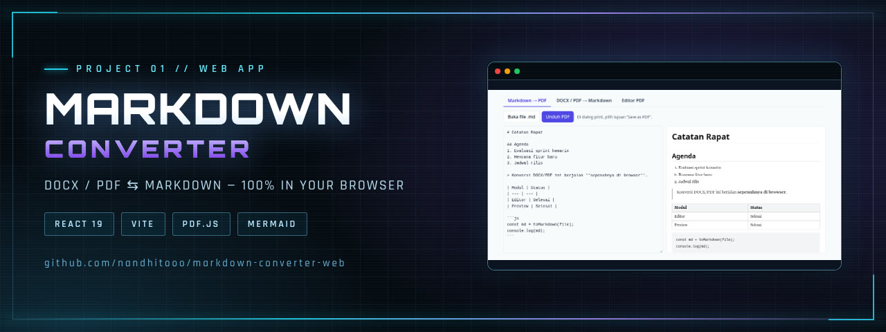
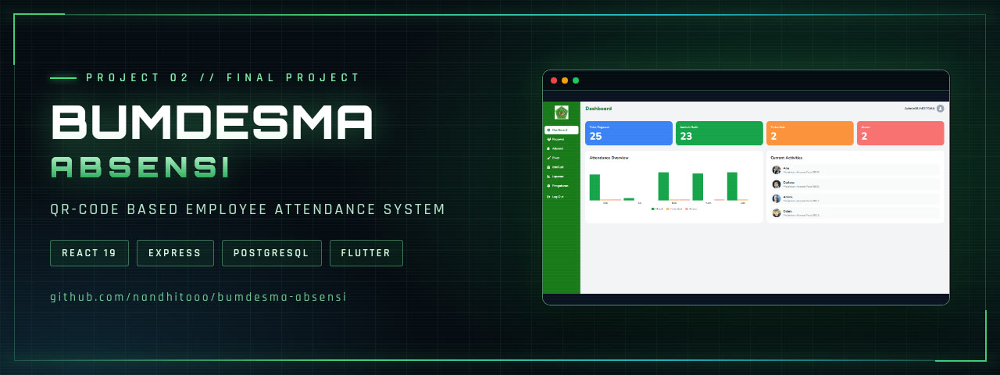
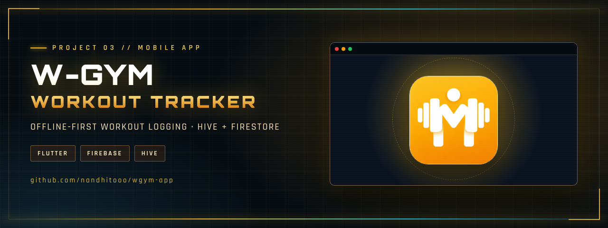
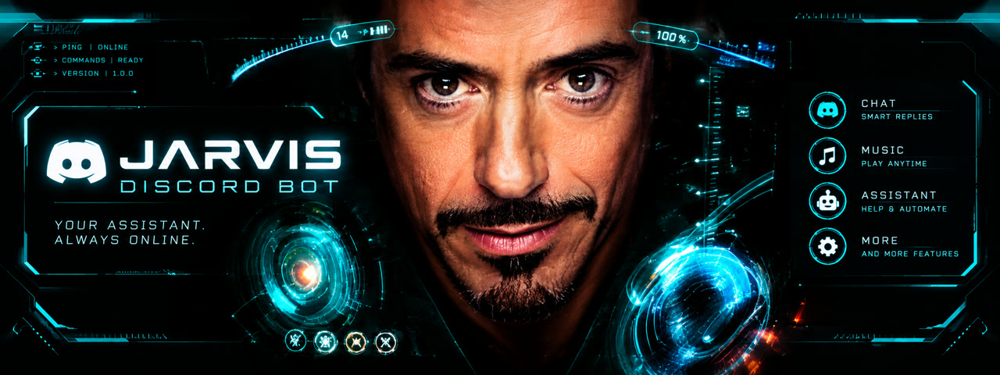
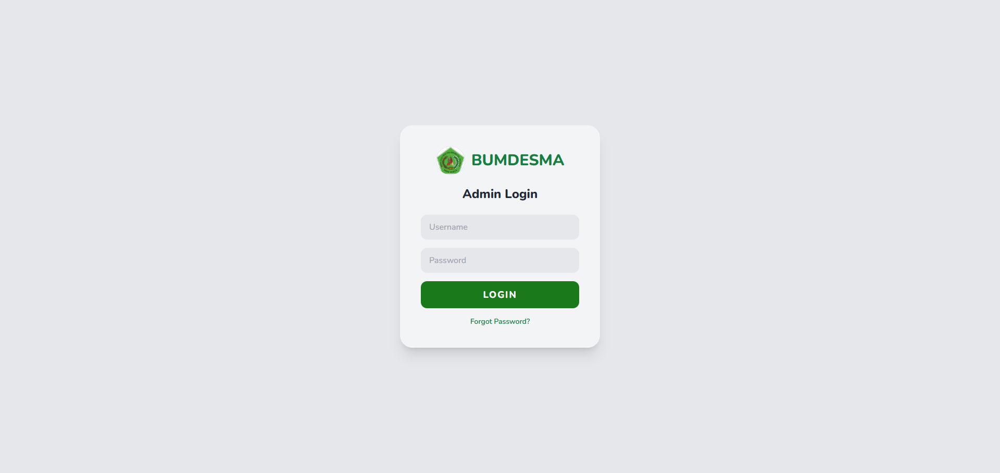
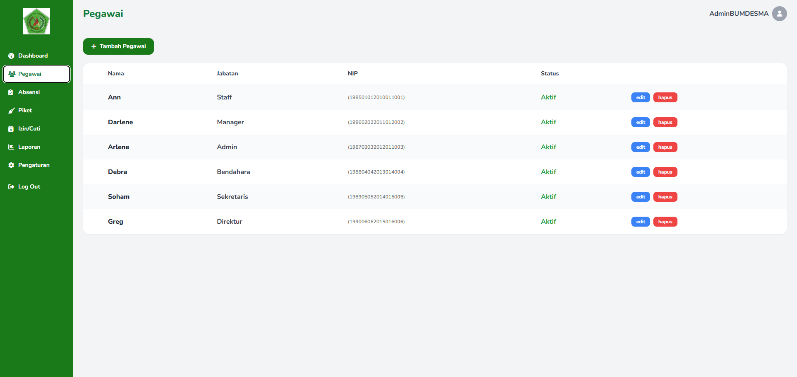
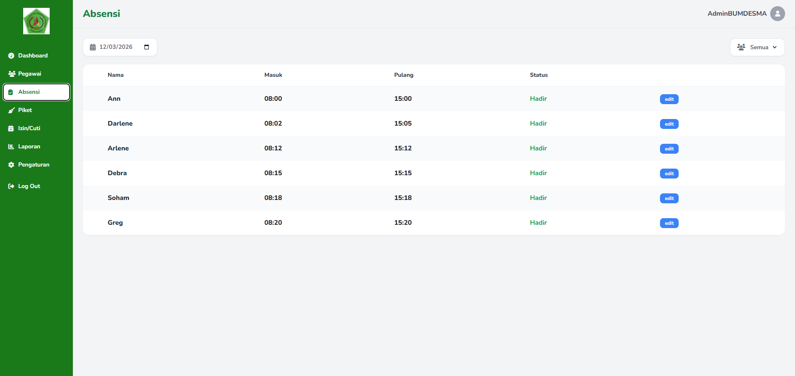
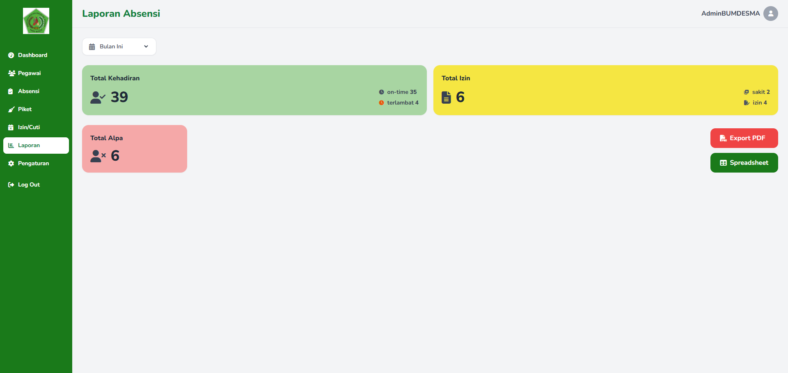

<div align="center">


### I build front-end experiences that are easy to use and work on any screen.

[](https://github.com/nandhitooo)
[](https://github.com/nandhitooo?tab=followers)
[](https://github.com/nandhitooo?tab=repositories)
[](#-lets-connect)

</div>

---

## 🧑‍💻 About Me

```yaml
name:      Nandhitooo
role:      Front-end Developer & Informatics Engineering Student
campus:    Electronic Engineering Polytechnic Institute of Surabaya (EEPIS / PENS)
location:  Surabaya, Indonesia
focus:     React, Tailwind CSS, responsive UI
motto:     "Learn by building, then make it better."
```

- 🔭 Currently building front-end projects and polishing my UI skills
- 🌱 Learning more about **React**, **JavaScript**, and clean component design
- 🤝 Open to collaborating on front-end and web projects
- 💬 Ask me about **HTML, CSS, JavaScript, React, or Tailwind CSS**
- ⚡ Fun fact: I care about the details most people never notice

<details>
<summary><b>🎯 What I'm working towards</b></summary>

<br/>

| Goal | Status |
| :--- | :--- |
| Ship a full React + Tailwind app | 🚧 In progress |
| Contribute to open source | 🌱 Starting out |
| Explore mobile with Flutter | 📱 Learning |
| Strengthen backend with Laravel / Node.js | 🧱 Learning |

</details>

---

## 🛠️ Tech Stack

<div align="center">

**Frontend**


**Backend & Database**


**Mobile & Tools**


</div>

---

## 🚀 Featured Projects

<div align="center">
<sub>A few things I've built — click any card to see the code.</sub>
</div>

<table>
<tr>
<td width="50%" valign="top">

<a href="https://github.com/nandhitooo/markdown-converter-web">
  
</a>

### 📝 [Markdown Converter](https://github.com/nandhitooo/markdown-converter-web)

Convert DOCX/PDF ⇄ Markdown right in the browser — files never leave your device. Live GFM preview, Mermaid diagrams, and print-to-PDF.


[🌐 Live Demo](https://markdown-converter-web.dhitopratama2005.workers.dev/) · [📂 Source](https://github.com/nandhitooo/markdown-converter-web)

</td>
<td width="50%" valign="top">

<a href="https://github.com/nandhitooo/bumdesma-absensi">
  
</a>

### 📋 [BUMDESMA Absensi](https://github.com/nandhitooo/bumdesma-absensi)

Final project: a QR-code based employee attendance system with admin & manager dashboards, leave requests, reports, and an employee mobile app — one npm-workspaces monorepo.


[📂 Source](https://github.com/nandhitooo/bumdesma-absensi) · [🖼️ More screenshots](https://github.com/nandhitooo/bumdesma-absensi/tree/main/frontend/screenshots)

</td>
</tr>
<tr>
<td width="50%" valign="top">

<a href="https://github.com/nandhitooo/wgym-app">
  
</a>

### 🏋️ [W-GYM](https://github.com/nandhitooo/wgym-app)

A Flutter workout tracker with an offline-first Hive + Firestore sync, calorie charts, BMI stats, dark mode, and English/Indonesian localization.


-F5A623?style=flat-square&logo=databricks&logoColor=white)

[📂 Source](https://github.com/nandhitooo/wgym-app)

</td>
<td width="50%" valign="top">

<a href="https://github.com/nandhitooo/jarvis-rust">
  
</a>

### 🤖 [Jarvis](https://github.com/nandhitooo/jarvis-rust)

**Discord bot, rewritten in Rust** — AI chat with model switching, image generation, moderation, and music streaming, with all Indonesian commands preserved from the Python original.


[📂 Source](https://github.com/nandhitooo/jarvis-rust)

</td>
</tr>
</table>

<details>
<summary><b>🖼️ BUMDESMA Absensi — screenshot gallery (click to expand)</b></summary>
<br/>

<table>
<tr>
<td width="50%"><p align="center"><sub>Login</sub></p></td>
<td width="50%"><p align="center"><sub>Employee management</sub></p></td>
</tr>
<tr>
<td width="50%"><p align="center"><sub>Attendance</sub></p></td>
<td width="50%"><p align="center"><sub>Reports</sub></p></td>
</tr>
</table>

</details>

<div align="center">

[](https://github.com/nandhitooo?tab=repositories)

</div>

---

## 📊 GitHub Stats

<div align="center">

<sub>Pulled live from GitHub — the numbers update on their own.</sub>

<table>
  <tr>
    <td width="49%" align="center" valign="top">
      
    </td>
    <td width="49%" align="center" valign="top">
      
    </td>
  </tr>
</table>


<table>
  <tr>
    <td width="44%" align="center" valign="top">
      
    </td>
    <td width="54%" align="center" valign="top">
      
    </td>
  </tr>
</table>


</div>

---

## 🐍 Contribution Snake

<div align="center">

<picture>
  <source media="(prefers-color-scheme: dark)" srcset="https://raw.githubusercontent.com/nandhitooo/nandhitooo/output/github-snake-dark.svg" />
  <source media="(prefers-color-scheme: light)" srcset="https://raw.githubusercontent.com/nandhitooo/nandhitooo/output/github-snake.svg" />
  
</picture>

</div>

---

## 🤝 Let's Connect

<div align="center">

[](https://discord.com/users/612285180492906506)
[](https://instagram.com/nandh1tooo_)
[](https://www.facebook.com/Nandhitooo/)
[](https://tiktok.com/@nandhitooo_)
[](https://pinterest.com/Nandhitooo_)
[](mailto:dhitopratama2005@gmail.com)

<sub>Thanks for stopping by — say hi if you want to build something together! ✨</sub>

</div>
